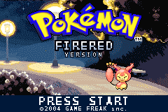

# Supa Titlescreen

Recreation of titlescreen code for FR.
- Animates Pokemon
- Easy to change background, logo and many more.



### Credits

Shiny Miner, Ansh(For layout
)
### Title screen (added)

`src/title_screen.c` is a real title screen that replaces the vanilla one at boot.
`hooks` patches `CB2_InitTitleScreen` (08078914) to jump to `CB2_InitSupaTitle`; it hands off to
`CB2_InitMainMenu` (0800C300) on A/Start. Both addresses are for BPRE 1.0.
Pick the image with `TITLE_IMAGE_INDEX` in `include/new/title_config.h`.

The title screen also shows an animated affine Pokemon (breathing squash/stretch, sway, bob, grow-in).
Configure it in `include/new/title_config.h` (`TITLE_MON_SPECIES`, `TITLE_MON_X`, `TITLE_MON_Y`, `TITLE_MON_CRY`).

Logo: `graphics/Logo.png` (240x160, 16 colours, index 0 transparent) is shown on its own layer above the scene.
Replace it with your own title art, or set `TITLE_LOGO 0` in `include/new/title_config.h`.

#### Title screen layers and settings

Everything is configured in `include/new/title_config.h`: the logo (`graphics/Logo.png`), the
blinking prompt (`TITLE_PROMPT_TEXT`), the copyright line (`TITLE_COPYRIGHT_TEXT`), the Pokemon,
its hop animation, and its ground shadow. Text is rendered at runtime from the font in
`include/new/title_assets.h`, so editing a string is a one-line change and a rebuild.

#### Logo and sub-title (updated)

* The "Pokemon" wordmark is 256-colour art in `include/new/title_logo_data.h`, generated from
  `title_assets/logo_source.png` by `tools/make_title_logo.py` (needs Python + Pillow).
  To use different art: `python tools/make_title_logo.py your_logo.png` (top-left pixel = transparent
  key colour; add `--banner x0,y0,x1,y1` if the auto-detected sub-title piece is wrong).
* The sub-title ("FIRERED" / "VERSION") is editable text, set in `include/new/title_config.h`
  (`TITLE_SUBTITLE_LINE1/2`). Set `TITLE_SUBTITLE 0` to use the original baked-in banner instead.

### Build Instructions

Build the same as the CFRU:  `python scripts/make.py`

The build system is smart enough to find enough free space on its own, and if you want it to be inserted at a particular address, you can specify it by updating the definition of `OFFSET_TO_PUT`:

```python
OFFSET_TO_PUT = 0x1C88650
SEARCH_FREE_SPACE = True   # Set to True if you want the script to search for free space
                           # Set to False if you don't want to search for free space as you for example update the engine
```

The build system will use `OFFSET_TO_PUT` to determine where in the ROM it should start looking for free space if `SEARCH_FREE_SPACE` is `True`.  Otherwise, the build system places the code to insert directly at `OFFSET_TO_PUT`.

#### Building the project itself

Once you're ready, run:

```shell
$ python scripts/make.py
```

This won't actually modify `BPRE0.gba`, instead your output will be in `test.gba`. Naturally, test it in an emulator before continuing.

